# Hotel Booking Cancellation Prediction: Model Comparison, Tuning & Selection

Six machine-learning models trained, cross-validated, tuned, stress-tested and explained for
predicting whether a hotel booking will be canceled, with a live web app to explore the
results and score new bookings.


> **Live web app:** [hotel-cancellation-prediction.onrender.com](https://hotel-cancellation-prediction.onrender.com) _(free tier: the first visit after idle can take ~30-60 s)_
> &nbsp;|&nbsp; **Decisions log:** [`docs/decisions.md`](docs/decisions.md)
> &nbsp;|&nbsp; **Walkthrough notebook:** [`notebooks/modeling.ipynb`](notebooks/modeling.ipynb)
> &nbsp;|&nbsp; **Task 2 (data preprocessing):** [hotel-booking-preprocessing](https://github.com/Krishna141414/hotel-booking-preprocessing)

VoidMain Technologies AI Internship - **Task 3: Machine Learning Application & Model Evaluation**.

---

## Overview

| Brief requirement | Where |
|---|---|
| A practical classification problem | Predict `is_canceled` at booking time (section [Problem](#problem)) |
| Multiple suitable algorithms | Dummy baseline + Logistic Regression, Decision Tree, Random Forest, HistGradientBoosting, KNN |
| Appropriate validation | Stratified hold-out test set (used once) + stratified 5-fold CV + temporal check |
| Compare with relevant metrics | PR-AUC (primary), ROC-AUC, F1, precision, recall, accuracy, confusion matrix, fold std, timings, size |
| Over/underfitting | Train vs CV vs test, learning curves, depth validation curve, boosting replay, decision boundaries |
| Justify the selected model | CV-only selection rule + generalisation gap + size + speed + interpretability ([section](#selected-model)) |

Everything runs with one command: `python main.py`.

## Problem

Hotels lose revenue when a canceled room stays empty, and lose goodwill when they overbook
and have to relocate a guest. Predicting which bookings will cancel lets a revenue manager
overbook *just enough*. The target is `is_canceled` (1 = canceled), predicted from what is
known **when the booking is made**. About **27.5%** of bookings are canceled, so
accuracy alone would mislead (always guessing "not canceled" is already 72.5% accurate).
Models are ranked on **PR-AUC**, the precision-recall trade-off for the canceled class.

## Dataset

**Hotel booking demand**: Nuno Antonio, Ana de Almeida, Luis Nunes (2019).
*Hotel booking demand datasets.* Data in Brief, 22, 41-49.
[doi.org/10.1016/j.dib.2018.11.126](https://doi.org/10.1016/j.dib.2018.11.126)

- Real bookings from a city hotel and a resort hotel in Portugal (arrivals July 2015 – August 2017).
- 119,390 rows x 32 columns, downloaded automatically from the public
  [TidyTuesday mirror](https://github.com/rfordatascience/tidytuesday/tree/main/data/2020/2020-02-11)
  (`"NULL"` read as missing, shape verified) and committed in `data/raw/`.
- **Cleaning and feature engineering are reused unchanged from Task 2**
  ([hotel-booking-preprocessing](https://github.com/Krishna141414/hotel-booking-preprocessing)):
  119,390 -> **87,208** rows (exact duplicates, zero-guest rows, negative ADR and impossible
  counts removed; ADR capped; structural missing values filled) and 10 engineered features
  -> 33 candidate inputs -> **31 model inputs** after this project's extra leakage precaution.
- **Leakage:** `reservation_status(_date)` (the outcome itself), `assigned_room_type` (set at
  check-in), `booking_changes` (counted up to the outcome date) and **`country` / `is_domestic`**
  (nationality may only be recorded at check-in) are excluded. An ablation confirms that adding
  the two post-booking columns back would inflate CV PR-AUC by +0.022
  ([decisions 3](docs/decisions.md#3-leakage-review)). Country is covered in
  [its own section](#with-vs-without-country-and-why-it-was-dropped).

## Pipeline

```mermaid
flowchart LR
    A[Raw CSV<br/>119,390 x 32] --> B[Task 2 cleaning<br/>+ features]
    B --> C[Leakage review<br/>31 inputs]
    C --> D[Stratified split<br/>80 / 20]
    D --> E[5-fold CV<br/>6 models in pipelines]
    E --> F[RandomizedSearchCV<br/>top 2, one-SE rule]
    F --> G[Select on CV:<br/>score, gap, size, speed]
    G --> H[Threshold on<br/>out-of-fold preds]
    H --> I[Test set<br/>used once]
    I --> J[Explain + temporal<br/>drift check]
    J --> K[final_model.joblib<br/>+ JSON cache]
    K --> L[Flask web app]
```

## Model comparison

5-fold stratified CV on the training set (mean ± fold std) and the held-out test set, both
at the default 0.5 threshold for F1. Fit time is on the full training set. KNN is trained on a stratified 20,000-row sample (it compares every prediction with every stored row). Full table: [`reports/model_comparison.csv`](reports/model_comparison.csv).

| Rank | Model | CV PR-AUC | CV ROC-AUC | CV F1 | Train PR-AUC | Test PR-AUC | Test ROC-AUC | Test F1 | Gap | Diagnosis | Fit (s) | Size (MB) |
|---:|---|---:|---:|---:|---:|---:|---:|---:|---:|---|---:|---:|
| 1 | Random Forest (tuned) | 0.716 ± 0.004 | 0.853 | 0.653 | 0.846 | 0.723 | 0.858 | 0.661 | 0.130 | Strong overfitting | 12.6 | 16.64 |
| 2 | **HistGradientBoosting (tuned)** ★ | 0.715 ± 0.005 | 0.852 | 0.648 | 0.769 | 0.721 | 0.855 | 0.654 | 0.055 | Mild overfitting | 5.7 | 0.89 |
| 3 | HistGradientBoosting | 0.715 ± 0.005 | 0.852 | 0.648 | 0.796 | 0.722 | 0.854 | 0.648 | 0.081 | Mild overfitting | 3.5 | 0.44 |
| 4 | Random Forest | 0.696 ± 0.004 | 0.847 | 0.645 | 1.000 | 0.704 | 0.851 | 0.652 | 0.304 | Strong overfitting | 13.7 | 80.59 |
| 5 | Logistic Regression | 0.673 ± 0.008 | 0.818 | 0.605 | 0.673 | 0.671 | 0.817 | 0.605 | 0.001 | Good fit | 0.9 | 0.01 |
| 6 | K-Nearest Neighbors | 0.613 ± 0.011 | 0.797 | 0.536 | 1.000 | 0.621 | 0.795 | 0.540 | 0.387 | Strong overfitting | 0.1 | 1.28 |
| 7 | Decision Tree | 0.421 ± 0.002 | 0.682 | 0.536 | 1.000 | 0.429 | 0.687 | 0.543 | 0.578 | Strong overfitting | 1.0 | 0.46 |
| – | Dummy (most frequent) | 0.275 ± 0.000 | 0.500 | 0.000 | 0.275 | 0.275 | 0.500 | 0.000 | 0.000 | Baseline | 0.4 | 0.01 |

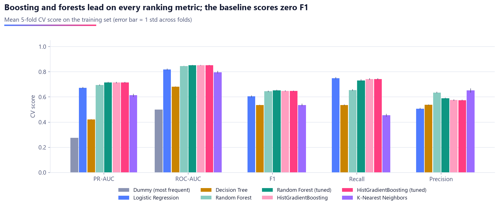

| ROC curves (test) | Precision-recall curves (test) |
|---|---|
| 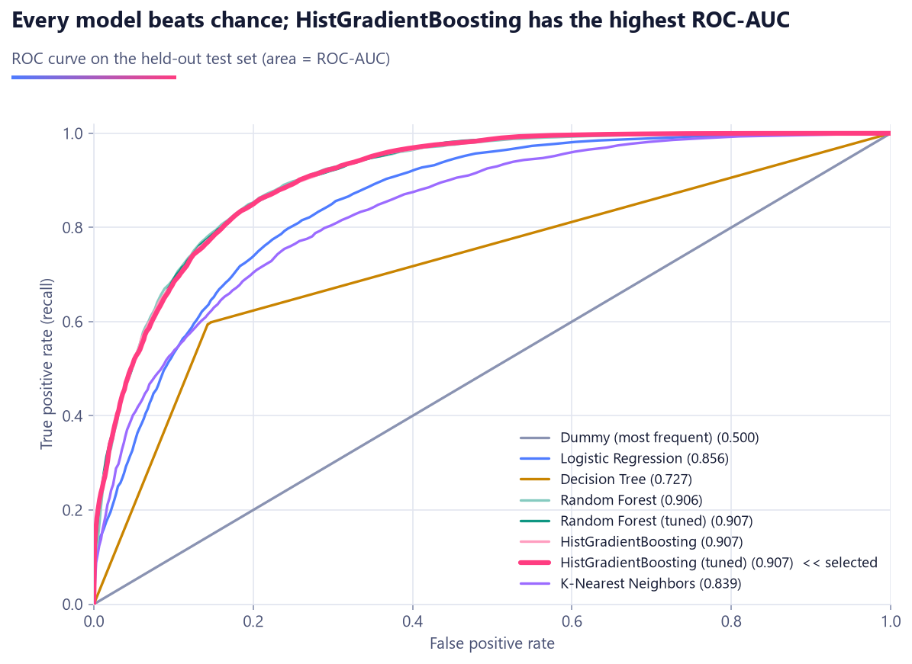 | 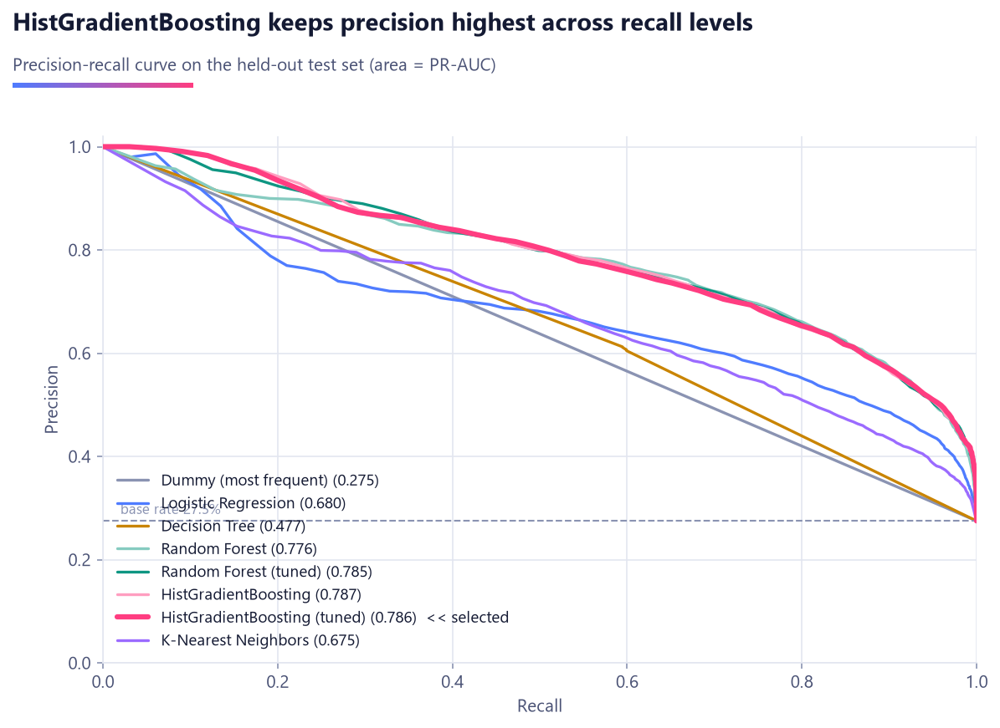 |

## Overfitting & underfitting

Train scores are the mean over the CV training folds, so "train vs CV" compares the very same
fits. Rule: gap > 0.05 PR-AUC = overfitting (> 0.10 strong); small gap but > 0.05 below the
best model = underfitting.

- **Decision Tree (no depth limit): strong overfitting.** Train 1.000 vs CV 0.421: it memorises individual bookings. The validation curve peaks at **depth 10**; deeper trees keep improving on train while CV falls.
- **KNN: strong overfitting.** Distance weighting scores every training row perfectly (train 1.000); CV 0.613.
- **Random Forest: large, partly benign gap.** Fully grown trees memorise (train 1.000), yet averaging still reaches CV 0.696. Tuning (bigger leaves, fewer features per split) lifts CV to 0.716 and shrinks the gap to 0.130.
- **Logistic Regression: good fit, on the underfitting border.** Train = CV (0.673 / 0.673), 0.04 below the boosted model (the underfitting margin is 0.05). A straight boundary cannot capture interactions, and its learning curve is nearly flat, so more data would not help.
- **HistGradientBoosting: best balance.** HistGradientBoosting (tuned) has a gap of 0.055 (mild overfitting) with the best CV score. Tuning uses a **one-standard-error rule**: among settings within one fold-std of the best CV score it picks the least-overfitting one, so tuning cannot buy noise-level gains with memorisation.
- The **decision-boundary playground** in the app shows the same thing visually: a deep tree on 2 features draws jagged islands (train PR-AUC ≈ 1.0, test far lower), while logistic regression draws one straight line.

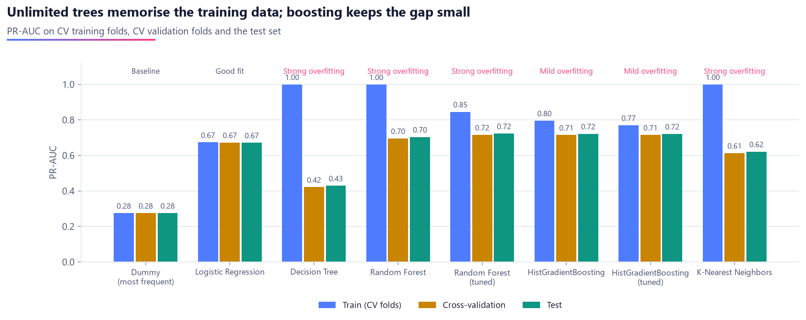

| Learning curves | Decision Tree depth (validation curve) |
|---|---|
| 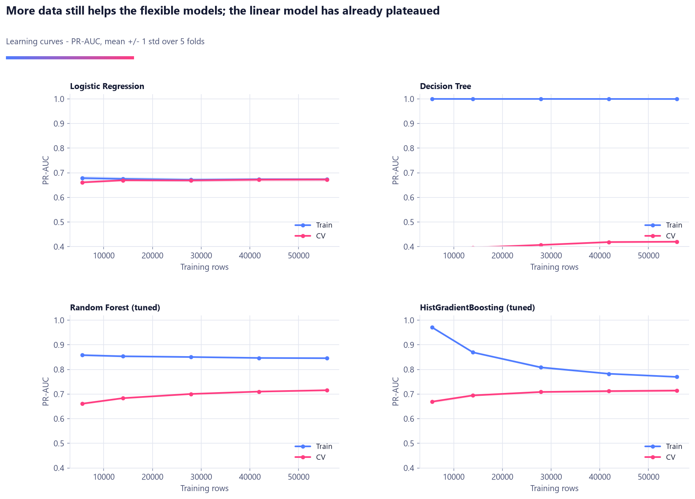 | 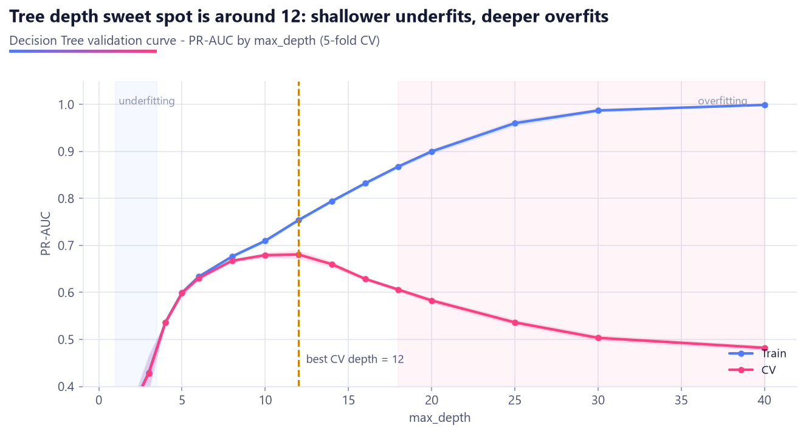 |

## Selected model

### ★ HistGradientBoosting (tuned)

Chosen by a rule that only looks at cross-validation (`src/train.py::select_final_model`):

1. **CV score:** tied for the best mean CV PR-AUC (0.7149 ± 0.0050). Models within 0.005 count as tied: Random Forest (tuned) (0.7157), HistGradientBoosting (tuned) (0.7149), HistGradientBoosting (0.7147).
2. **Generalisation gap:** the smallest train-CV gap among the tied models (0.055) vs 0.130 for Random Forest (tuned).
3. **Deployment size and speed:** 0.89 MB and 7 ms per 1,000 predictions, vs 16.6 MB / 21 ms for Random Forest (tuned). That matters on a 512 MB free instance.
4. **Interpretability:** medium: additive trees, explained with permutation importance; per-prediction "why" bars in the app. Logistic Regression would be fully transparent but costs 0.04 PR-AUC.
5. **CV was honest:** test PR-AUC 0.721 vs CV 0.715.

Hyperparameters: `min_samples_leaf=40`, `max_leaf_nodes=63`, `max_iter=300`, `learning_rate=0.03`, `l2_regularization=0.1`

**Final test-set results** (single evaluation, threshold tuned on out-of-fold training predictions):

| Metric | Threshold 0.50 | Tuned threshold 0.54 |
|---|---:|---:|
| Accuracy | 0.7836 | 0.7960 |
| Precision | 0.5836 | 0.6120 |
| Recall | 0.7445 | 0.7062 |
| F1 | 0.6543 | 0.6557 |
| ROC-AUC | 0.8553 | 0.8553 |
| PR-AUC | 0.7210 | 0.7210 |

At 0.54 the model catches **3,389 of 4,799 cancellations** (70.6%), and **61.2%** of its alarms are right (2,149 false alarms among 12,643 kept bookings). The threshold maximises F1 on out-of-fold training predictions; a recall ≥ 80% policy would use 0.43.

| Confusion matrix (test) | Threshold tuning (out-of-fold) |
|---|---|
| 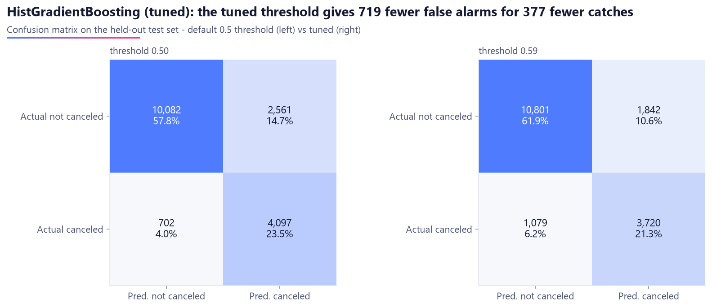 | 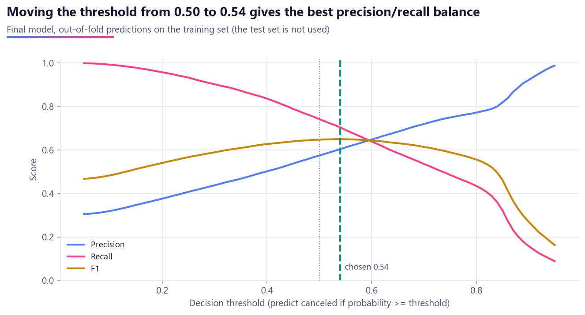 |

## With vs without country (and why it was dropped)

Nationality (`country`, and `is_domestic` derived from it) is a strong signal, but canceled
bookings never reach check-in, and some hotel systems only record or correct nationality
there. If that happened in this dataset, the column partly encodes "the guest showed up",
which is the outcome. Portuguese guests are 31% of bookings but 41% of
cancellations, a pattern too strong to trust without knowing how it was recorded. So the
**safer option** was taken: the deployed model does not use nationality. The same model
settings with country added back, as an evaluation-only ablation:

| HistGradientBoosting (tuned) | Without country (deployed, 31 inputs) | With country (33 inputs) | Difference |
|---|---:|---:|---:|
| CV PR-AUC | 0.715 | 0.778 | +0.064 |
| CV ROC-AUC | 0.852 | 0.904 | +0.052 |
| Test PR-AUC | 0.721 | 0.783 | +0.062 |
| Test ROC-AUC | 0.855 | 0.906 | +0.051 |
| Test F1 @ 0.54 | 0.656 | 0.719 | +0.063 |
| Test recall @ 0.54 | 0.706 | 0.824 | +0.117 |

The precaution costs 0.064 CV PR-AUC. If the hotel confirms nationality is entered at
booking time, the "with country" model would be the better choice
([decisions 3.5](docs/decisions.md#35-country--is_domestic---dropped-the-safer-option-kept-as-an-ablation)).

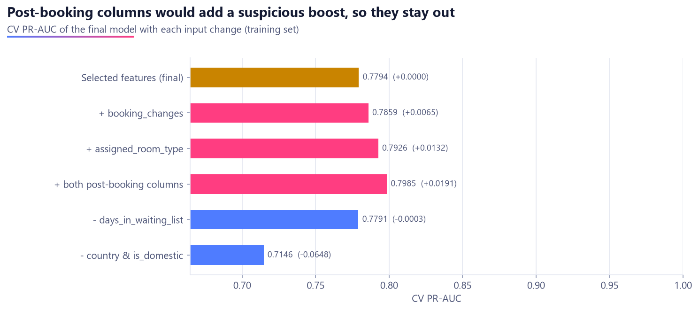

## Explainability

Permutation importance of the final model on the test set (drop in PR-AUC when one input is shuffled):

1. **total_of_special_requests**: Bookings with 1+ total_of_special_requests cancel 22%, vs 33% with none.
2. **lead_time**: Top quarter of lead_time (>= 125) cancels 38%, bottom quarter (<= 11) 10%.
3. **previous_cancel_ratio**: Bookings with previous_cancel_ratio > 0 cancel 67%, vs 27% otherwise.
4. **market_segment**: market_segment = Online TA cancels 35% of the time, vs 12% for Corporate.
5. **agent**: agent = 9 cancels 40% of the time, vs 6% for 28.
6. **deposit_type**: deposit_type = Non Refund cancels 95% of the time, vs 27% for No Deposit.

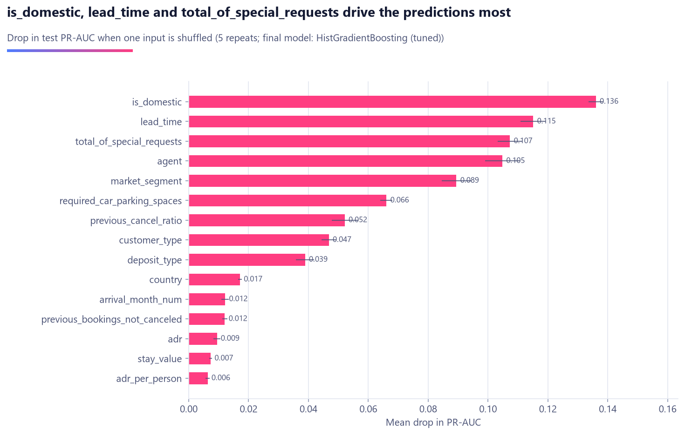

## Temporal validation (does it hold up next season?)

Train on arrivals **2015-07-01 → 2017-05-01**, test on **2017-05-02 → 2017-08-31** (17,544 bookings):

| Model | Random split PR-AUC | Temporal PR-AUC | Temporal ROC-AUC |
|---|---:|---:|---:|
| Logistic Regression | 0.671 | 0.677 | 0.790 |
| Decision Tree | 0.429 | 0.429 | 0.617 |
| Random Forest | 0.704 | 0.640 | 0.778 |
| Random Forest (tuned) | 0.723 | 0.653 | 0.788 |
| HistGradientBoosting | 0.722 | 0.666 | 0.791 |
| HistGradientBoosting (tuned) | 0.721 | 0.670 | 0.792 |
| K-Nearest Neighbors | 0.621 | 0.572 | 0.735 |

The latest period cancels **34.7%** of bookings vs 25.7% before, and its months are under-represented in training. ROC-AUC drops for every model, and the tree ensembles lose the most: on the later period Logistic Regression has the best PR-AUC (0.677 vs 0.670 for the selected model), while the selected model keeps a marginally better ROC-AUC (0.792 vs 0.790). Part of what the ensembles learn is season-specific. That's real **data drift** that a random split hides. Selection still uses CV by design, but the realistic score next season is closer to 0.67 than 0.72. In production: retrain on a rolling window, re-check the threshold each season, and keep Logistic Regression as a monitored fallback.

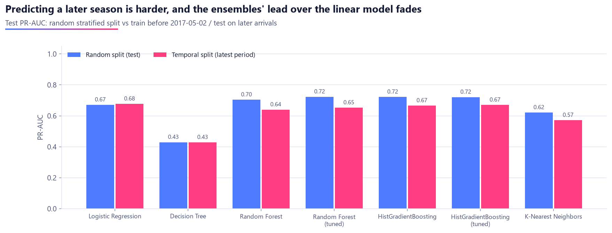

## Web app

**CancelSense** (Flask + hand-written HTML/CSS/JS, Chart.js, D3, Plotly; light and dark mode;
responsive):

| Page | What it shows |
|---|---|
| **Overview** | Problem, dataset, pipeline, selected model, headline test metrics, top-3 leaderboard |
| **Model comparison** | Kaggle-style leaderboard with a "why it won" card, grouped bars (CV/test toggle), radar, sortable table, ROC + PR curves of all models, confusion matrix, head-to-head mode, fit/predict time and size, tuning scatter |
| **Overfitting** | Train vs CV vs test per model, learning curves, depth validation curve, gradient-boosting training replay (play/pause), decision-boundary playground (2 features x 5 models), temporal validation, leakage ablation |
| **Explainability** | Permutation importance + plain-English insights, tree importances, Logistic Regression weights, zoomable/collapsible D3 decision tree, "falling bookings" animation, rotatable 3-D PCA booking space |
| **Predict** | Full booking form with live what-if updates, animated risk gauge, "why this prediction" bars, what-if curves, random real test booking (with its true outcome), threshold slider, business-impact calculator |

A model switcher at the top of the analysis pages updates every chart for the chosen model.
Screenshots: [`screenshots/`](screenshots/).

## How to run

Requires Python 3.14 (same as Task 2). Windows PowerShell shown; on macOS/Linux use
`source .venv/bin/activate`.

```powershell
git clone https://github.com/Krishna141414/hotel-cancellation-prediction.git
cd hotel-cancellation-prediction
py -3.14 -m venv .venv
.venv\Scripts\activate
pip install -r requirements-dev.txt

python main.py               # full run, ~16 min: data -> compare -> tune -> select -> evaluate -> save
python main.py --quick       # ~7 min smoke test (tiny tuning budget)
python main.py --figures-only  # redraw reports/figures from the saved results

pytest                       # tests
ruff format --check . ; ruff check .

flask --app app.app run      # web app on http://127.0.0.1:5000
```

The dataset downloads automatically on the first run (verified to be 119,390 x 32) and is
also committed in `data/raw/`. The trained model and the web-app cache are committed too, so
the app runs straight after `pip install`, without training.

## Project structure

```
data/raw/hotel_bookings.csv   raw dataset (committed, read-only)
notebooks/modeling.ipynb      full walkthrough, executed with outputs
src/
  config.py                   every path, column list, hyperparameter, threshold and colour
  download_data.py            download + shape check (Task 2)
  data.py                     load + clean (Task 2's load_data.py + cleaning.py)
  features.py                 feature engineering + selection checks (Task 2) + preprocessors + splits
  models.py                   model zoo: every algorithm in a Pipeline with its preprocessing
  train.py                    CV, RandomizedSearchCV, selection, OOF threshold, curves, temporal, ablation
  evaluate.py                 metrics, curves, over/underfitting diagnosis, thresholds, importances
  insights.py                 tree JSON, falling-bookings paths, decision boundaries, PCA, boosting replay
  visualize.py                shared figure style + 16 figures
models/                       final_model.joblib + metrics.json
reports/                      model_comparison.csv + figures/
app/                          Flask app (app.py, services.py, build_cache.py, templates/, static/, cache/)
tests/                        pytest: data, features, preprocessing, models, train, evaluate, insights, app
docs/decisions.md             every decision: what, why, alternative considered
screenshots/                  (empty, for submission screenshots)
main.py                       one command for everything
render.yaml, gunicorn.conf.py deployment
```

## Tech stack

Python 3.14 · pandas 3.1 · NumPy 2.5 · scikit-learn 1.9 · matplotlib 3.11 · Flask 3.1 +
gunicorn · Chart.js 4.4, D3 7.9 and Plotly.js 2.35 (CDN, pinned) · pytest · ruff.
XGBoost/LightGBM are not used: HistGradientBoosting is scikit-learn's own LightGBM-style
booster, and skipping them keeps the deploy small (see decisions 5.5).

## Deploying on Render (free tier)

`render.yaml` is a Render Blueprint. Either use **New -> Blueprint** with this repo, or
create a **Web Service** by hand:

| Setting | Value |
|---|---|
| Runtime | Python 3 |
| Branch | `main` |
| Build command | `pip install -r requirements.txt` |
| Start command | `gunicorn app.app:app` |
| Health check path | `/healthz` |
| Instance type | Free |
| Environment variable | `PYTHON_VERSION` = `3.14.0` |

Nothing is trained on the server: it loads the committed (< 1 MB) model and ~0.5 MB of JSON
(about 200 MB RAM in total, well under the 512 MB limit).

## Credits

- Dataset: Antonio, N., de Almeida, A., & Nunes, L. (2019). *Hotel booking demand datasets.* Data in Brief, 22, 41-49.
- Data cleaning and feature engineering: my Task 2 project,
  [hotel-booking-preprocessing](https://github.com/Krishna141414/hotel-booking-preprocessing) (reused unchanged).
- Built by **Krishna** (B.Tech AI & ML) for the VoidMain Technologies AI Internship, Task 3.
